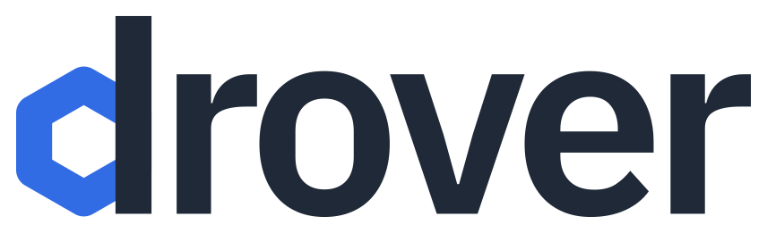

<p align="left">
  
  
  <a href="https://github.com/evil8io/drover/releases">
    
  </a>
  <a href="https://github.com/evil8io/drover/actions/workflows/ci.yml">
    
  </a>
</p>

<p align="center">
  
</p>

---

# Multi-tenancy extension for SUSE Rancher

**drover** is a set of extensions for [Rancher](https://github.com/rancher/rancher).

Rancher provides centralised authentication, authorization, project management, and self-service for its users. drover adds these features for the tenants of the Rancher projects:

- A tenant lists the namespaces of its projects through the Kubernetes API. Client applications such as kubectl and k9s then show these namespaces.
- Each namespace gets a configured set of labels and annotations of its project.
- A client outside the cluster, for example a CI job, gets a short-lived token for a project without a stored secret.
- Kyverno isolates the tenants from each other with a baseline of policies.

# What drover does

The goal of drover is to improve the developer experience with Kubernetes clusters that Rancher manages. drover does this with a set of Helm charts:

| Chart | Location | Management Cluster | Workload Cluster | Description |
| --- | --- | --- | --- | --- |
| drover | [charts/drover](https://github.com/evil8io/charts/tree/main/charts/drover) | ✅ | ❌ | A set of services that improve the developer experience. |
| drover-policies | [charts/drover-policies](https://github.com/evil8io/charts/tree/main/charts/drover-policies) | ✅ | ✅ | A strict baseline of Kyverno policies. With these policies, Kyverno isolates tenants, and it forces a secure configuration for workloads. |

## Services

| Service | Subcommand | Function | Docs |
| --- | --- | --- | --- |
| API filter | `api-filter` | A reverse proxy in front of Rancher. It lets users list their project namespaces with kubectl. It also limits the `--all-namespaces` flag to their project namespaces. | [docs/api-filter.md](docs/api-filter.md) |
| Project sync | `project-sync` | A service that copies a configured set of labels and annotations from a Rancher project to the namespaces of that project. With `--service-accounts`, it also keeps three ServiceAccounts per project, one per project role. With `--openbao-address` as well, it writes the OpenBao config for the [short-lived credentials](#short-lived-credentials). | [docs/project-sync.md](docs/project-sync.md) |
| Token rotation | `rotate-token` | A command that rotates the API token of a Rancher service user of drover. With `--password-secret`, it also writes the password hash of that user. It reads the password from a file. A CronJob runs the command. | [docs/rotate-token.md](docs/rotate-token.md) |

## Example

```
$ kubectl get namespaces
No resources found

$ kubectl create namespace shire
namespace/shire created

$ kubectl create namespace gondor
namespace/gondor created

$ kubectl get namespaces -L project.name
NAME     STATUS   AGE   PROJECT.NAME
shire    Active   15s   Middle-Earth
gondor   Active   10s   Middle-Earth

$ kubectl get configmap --all-namespaces
NAMESPACE   NAME               DATA   AGE
shire       kube-root-ca.crt   1      15s
gondor      kube-root-ca.crt   1      10s
```

## Short-lived credentials

A client outside the cluster, for example a CI job, needs a Kubernetes credential to work in the namespaces of a project. With drover, the client does not need a stored secret:

1. The client logs in to [OpenBao](https://openbao.org) with the identity that it already has: the JWT of its CI system, or its AWS IAM role.
2. OpenBao returns a token of a ServiceAccount of the project. With the default values of the chart, the token is valid for 15 minutes.
3. The client uses the token through Rancher, for example with kubectl or helm.

In an annotation of the Rancher project, a project owner lists the identities that can log in, each with a project role.

- Helm installs OpenBao from the [drover chart](https://github.com/evil8io/charts/tree/main/charts/drover). The README of the chart contains the values and the format of the annotation.
- [drover-login-action](https://github.com/evil8io/drover-login-action) is a GitHub Action that does these steps in a workflow.
- The OpenBao objects that `project-sync` writes are in [docs/project-sync.md](docs/project-sync.md).

## Contributing

See [CONTRIBUTING.md](CONTRIBUTING.md).

## License

[Apache License 2.0](LICENSE)
